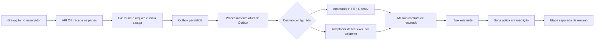

# Estudo da API OpenAI para transcrição do Clínica

Data de consulta das fontes: **27/10/2026**.
Estado: estudo concluído e implementação local preparada. Configuração, limites
efetivos e validação estão em [OPENAI_TRANSCRIPTION.md](OPENAI_TRANSCRIPTION.md).
Homologação real e publicação continuam pendentes. As seções abaixo preservam o estudo e seu plano original.

## 1. Recomendação

**Decisão arquitetural explicitada pelo usuário:** manter um único fluxo
**Saga -> Outbox -> execução externa -> Inbox -> Saga**, qualquer que seja o provedor.
OpenAI e o executor Codex são ambos executores externos. A saga sempre publica a
mesma intenção, aguarda resposta e aplica o mesmo contrato de resultado.

A seleção por configuração confiável pertence ao **processamento da Outbox**.
Nesse ponto, a implementação OpenAI chama a API HTTP; a implementação de executor
externo publica pela fila já existente. Aproveitar o Worker C# e o padrão de
seleção/Strategy existente, sem outro host, Worker ou serviço de roteamento.

O C# já recebe e reúne as partes da gravação. O envio/preparo do arquivo pertence
ao adaptador executado depois da Outbox. Mesmo quando a API HTTP devolve texto na
própria chamada, esse texto entra pelo contrato comum de Inbox, sem aplicação
direta na saga. O resumo continua sendo outra etapa, com pedido e resultado próprios.

Este desenho substitui as propostas anteriores de chamar a API dentro do step
ou escolher, no Receiver da saga, entre resultado imediato e espera externa.
Esses dois caminhos não fazem parte da direção atual.

**Limite de escopo confirmado pelo usuário:** preservar a gravação e as telas
atuais, o envio dos chunks e sua recepção/junção pelo C#. O usuário informa que
esse fluxo já funciona. A nova integração começa no arquivo já finalizado.
O estudo não propõe reescrever a criação de áudio nem o upload. Se o provedor
exigir preparo de formato/tamanho, esse tratamento ocorre depois, no Worker.

Essa direção evita a passagem obrigatória pelo executor Python/Codex descrito em
[CODEX_EXECUTOR.md](CODEX_EXECUTOR.md) quando a Outbox tem OpenAI como destino.
O executor anterior permanece como alternativa de execução externa, ainda pendente
de homologação; este estudo não o remove nem ativa outro fluxo.

A tela recebe a confirmação do upload sem aguardar a OpenAI. Não há novo endpoint
intermediário, host, container ou consumidor Python para fazer essa transcrição.
O modelo de fala é executado pelo provedor, sem carregar Whisper/Torch no servidor.
O consumo de CPU, memória e disco da preparação local ainda deve ser medido.

## 2. Modalidade e modelo

O requisito atual é transcrever uma gravação concluída. A recomendação oficial
para esse caso é a transcrição de arquivos com **gpt-transcribe**. O guia informa
suporte a WebM e limite de **25 MB por arquivo**. Isso permite aproveitar o áudio
da gravação quando compatível, sem conversão obrigatória.
[Guia oficial](https://developers.openai.com/api/docs/guides/speech-to-text).

Proposta inicial do projeto: português, retorno completo em JSON e sem streaming
para a tela. Não acrescentar transcrição ao vivo nesta entrega. Necessidades de
identificar cada interlocutor ou produzir marcações temporais ficam fora do MVP;
precisam de avaliação própria, sem presumir que todos os modelos tenham os mesmos
recursos. A disponibilidade na conta ainda não foi testada.

Não iniciar uma integração nova nos modelos legados apenas para reaproveitar
exemplos: a OpenAI anunciou o desligamento de whisper-1, gpt-4o-transcribe,
gpt-4o-mini-transcribe e gpt-4o-transcribe-diarize em **26/02/2027**.
[Descontinuações](https://developers.openai.com/api/docs/deprecations).

## 3. Contrato HTTP a utilizar

| Elemento | Escolha para o piloto |
| --- | --- |
| Método e endereço | POST https://api.openai.com/v1/audio/transcriptions |
| Autenticação | Bearer com chave da API, fornecida pelo cofre privado ao Worker |
| Corpo | multipart/form-data |
| file | Conteúdo binário, com nome/extensão e Content-Type correspondentes ao formato real |
| model | gpt-transcribe |
| languages[] | pt |
| Resposta | JSON; extrair text e aceitar metadados adicionais conhecidos pelo contrato |

A referência descreve o upload e a resposta com texto e metadados de idioma/uso.
[Referência da operação](https://developers.openai.com/api/reference/resources/audio/subresources/transcriptions/methods/create).
Para esse modelo, usar **languages**, substituindo **language**, sem enviar ambos.
[Parâmetro do modelo](https://developers.openai.com/api/docs/guides/speech-to-text#add-transcription-context).

Decisões propostas para o cliente C#:

- Usar HttpClient registrado por DI, StreamContent e MultipartFormDataContent.
  Para esse único endpoint, HTTP direto evita acrescentar um SDK apenas como
  repassador; reavaliar se surgir necessidade concreta de outras operações.
- Abrir o áudio como stream. Não transformar o arquivo inteiro em base64, string
  ou byte[] em memória. Encerrar streams, resposta HTTP e arquivos temporários.
- Propagar cancelamento e impor limite de tempo por envio e por execução completa.
  Valores finais dependem da medição com os áudios representativos.
- Validar text, tamanho suportado pelo armazenamento e resposta integral antes de
  avançar a saga. Não interpretar JSON desconhecido como sucesso nem truncar texto.
- Começar sem glossário ou instruções clínicas no prompt. Se termos técnicos
  exigirem contexto, avaliar depois com exemplos e comparação de fidelidade.
- Não enviar identificadores de paciente, prontuário anterior ou demais dados
  cadastrais quando apenas o áudio é suficiente para cumprir essa tarefa.

Isso é especificação para implementação posterior, não uma chamada já executada.

## 4. Localização no Yeshua

| Parte existente | Responsabilidade proposta |
| --- | --- |
| API / Receiver de upload | Autenticar, validar a sessão, salvar partes e finalizar o arquivo |
| Saga / Receiver da transcrição | Publicar a intenção na Outbox e aguardar a resposta pela Inbox, sempre do mesmo modo |
| Processador atual da Outbox | Selecionar o adaptador de entrega externa por configuração confiável e manter o controle de entrega/retry |
| Contrato local do aplicativo | Pedido de transcrição e resultado normalizado, iguais para todos os executores |
| Infrastructure.Shared do Clínica | Implementações de entrega OpenAI HTTP e executor por fila, escolhidas na borda da Outbox |
| Repositories do Clínica | Ler associação do upload e persistir saga, step e resultado |
| Worker do Clínica | Hospedar e executar o processamento em segundo plano |

O Domain mantém somente contratos próprios quando esse for o caminho de extensão
vigente; não recebe HttpClient nem tipos de SDK externo. Não criar projeto novo ou
framework genérico de provedores. A integração específica não pertence à Engine
nem ao Shared global. A Engine deve mudar apenas onde a execução gerada realmente
precisar de adequação.

### 4.1. Ponto único de troca: entrega da Outbox

O ponto concreto encontrado é yOutBoxWorkerHandler. O template
SourceCodeApplicationSagaQueueWorkers já centraliza claim, publicação, confirmação,
retry e dead letter. Hoje esse processador aceita apenas transporte de fila e
chama IQueuePublisher. A implementação futura deve ampliar essa borda para
selecionar a entrega da operação de transcrição, sem mover a decisão para a saga.

O projeto tem o padrão Strategy/fábrica com DI e switch explícito, exemplificado
por INotification/NotificationFactory. Aproveitar esse padrão de seleção na
Outbox, sem criar um roteador remoto ou um sistema de plugins. A declaração atual
de Strategy está ligada a use cases e o gerador tem convenções de Notification;
detalhar o menor ajuste para o ponto de entrega, sem criar um command artificial
ou estender SagaStep com seleção de provedor apenas para encaixar essa integração.

| Destino da Outbox | Responsabilidade do adaptador |
| --- | --- |
| OpenAI | Preparar/enviar o arquivo por HTTP e encaminhar o retorno normalizado à entrada comum de Inbox |
| ExecutorExterno | Publicar o mesmo pedido pela fila existente; receber o retorno normalizado pela entrada comum de Inbox |

O adaptador de OpenAI não modifica a saga nem o prontuário. O fato de o pedido HTTP
ter resposta na própria conexão não transforma a execução em step interno.
O processamento da Inbox continua sendo quem libera a aplicação na saga.

A saga não recebe um resultado alternativo do tipo concluído-ou-enfileirado para
decidir seu caminho. Ambos os destinos obedecem ao mesmo pedido/resultado externo.
O tipo de entrega, o endereço e a credencial ficam na infraestrutura. Distinguir
a confirmação de entrega do pedido da aplicação do resultado de negócio.

O retorno comum conserva messageId, requestId, correlationId, status, result e
error. No sucesso, result contém {text}; os status existentes de transcrição são
mantidos. Preservar escopo e identidade causal. A entrada comum valida operação
declarada, saga/step, tentativa e duplicidade, independentemente do transporte.

Hoje InboxListenerHandler reconhece a rota pelo nome da fila. Para HTTP, adaptar
essa validação para o contrato lógico declarado, reaproveitando o mesmo Receiver
e persistência. Não fabricar um nome de fila nem pular validações para inserir a
resposta HTTP. Não criar outra tabela Inbox ou uma gravação direta no step.

A seleção fica vinculada à mensagem/tentativa lógica antes do primeiro envio e é
preservada nos retries usando a metadata existente da Outbox. Alterar configuração
afeta mensagens ainda não vinculadas a um destino, nunca redireciona silenciosamente
um pedido em voo. Não adicionar fallback automático nem novos campos/tabelas sem
comprovar uma necessidade que a metadata atual não resolva.

## 5. O que o C# já faz e o papel do FFmpeg

O SendFileHandler customizado já salva cada chunk, verifica a sequência na
finalização e copia as partes em ordem para um único arquivo usando streams.
Em seguida vincula o upload à sessão e inicia PsychologySessionInsight.
Isso reúne partes da mesma gravação; não é um editor que combina gravações
independentes. No piloto da nova integração, usar uma gravação das telas atuais
como entrada, preservando esse fluxo existente.

O gravador atual usa MediaRecorder com intervalo nominal de **dez segundos**.
Esses blobs servem ao transporte e à recuperação do upload; não são garantidos
como arquivos de áudio independentes. A especificação permite que apenas sua
combinação completa seja reproduzível.
[MediaStream Recording, W3C](https://www.w3.org/TR/mediastream-recording/#mediarecorder-methods).
Por isso, o piloto mantém a junção pelo C# e não envia cada chunk bruto isoladamente
à API de arquivos. Fazer transcrição durante a gravação exigiria validar arquivos
independentes ou uma integração de áudio ao vivo, que é outro comportamento.
[Modalidades da OpenAI](https://developers.openai.com/api/docs/guides/transcription).
Isso não impede o envio de trechos completos preparados depois da junção, quando
necessário para o tamanho; são unidades diferentes dos chunks do upload.

Há uma observação de compatibilidade para o novo cliente: o gravador admite
alternativas WebM, Ogg e MP4, enquanto o fechamento atual nomeia o resultado
audio.webm. O Worker deve identificar o formato efetivo antes de chamar o provedor,
sem deduzi-lo apenas desse nome fixo. Essa observação não implica trocar o gravador
ou o upload. Não basta renomear um arquivo para convertê-lo.

O FFmpeg não transcreve fala. O executor antigo o usava para preparar WAV mono
16 kHz para Whisper. O protótipo posterior o usa para gerar MP3 mono a 64 kbps e
segmentos de dez minutos. No desenho C#, ele será um utilitário chamado pelo
Worker somente quando a preparação for necessária; não depende de Python.

Plano de preparação, com parâmetros iniciais sujeitos à homologação:

1. Validar arquivo, formato, integridade e tamanho. Quando for necessário examinar
   metadados, usar os recursos de mídia já disponíveis, como ffprobe junto do FFmpeg.
2. Enviar o original compatível quando abaixo do limite interno proposto de
   **24.000.000 bytes**, uma margem de implantação inferior ao limite do provedor.
3. Acima dessa margem, avaliar MP3 mono a 64 kbps e verificar o tamanho produzido.
   Não converter sempre para WAV: o arquivo descomprimido pode aumentar bastante.
4. Se ainda exceder a margem, gerar trechos reproduzíveis em ordem temporal,
   inicialmente com alvo de até dez minutos, verificando cada arquivo. Preferir
   fronteiras de pausa quando viável e testar perdas/duplicações nas transições.
5. Enviar partes sequencialmente no piloto e compor a transcrição na ordem correta.
   Só concluir a etapa depois de validar o conjunto completo.

A 64 kbps, dez minutos equivalem aproximadamente a **4,8 MB** antes de pequenos
overheads. É uma estimativa de tamanho, não garantia de qualidade. A preparação
precisa preservar fala inteligível. Não dividir o áudio cortando bytes arbitrários.

Para manter o MVP pequeno, a primeira versão não promete retomar somente a parte
que falhou: uma tentativa pode repetir partes e gerar novo consumo. Se isso se
tornar relevante, planejar checkpoint durável no estado existente, com versão e
identidade do áudio; não criar um segundo controlador de jobs em arquivos voláteis.

## 6. Comportamento único da saga

AudioTranscriptRequested permanece uma espera externa. O comportamento é sempre:

1. Persistir a intenção de transcrição na Outbox, no mesmo ciclo transacional do step.
2. Entrar em WaitingResponse, sem conhecer o provedor ou fazer HTTP.
3. Receber pela Inbox o resultado do contrato declarado.
4. Aplicar/validar {text} e continuar para o resumo, ou tratar a falha pelo caminho existente.

Preservar as chaves de steps, a identidade causal, o vínculo Sesoes/upload e a
validação de tentativa. A transcrição permanece no estado persistido do primeiro
step, sem virar Prontuario nem assumir o limite de 8.000 caracteres do resumo.
Retry somente do resumo não deve refazer uma transcrição já concluída.

Não reclassificar o step como execução interna, não acrescentar seleção de provedor
ao seu miolo e não migrar ISagaStepHandler para async por causa da OpenAI. O I/O
externo ficará no processador da Outbox, cuja borda já é assíncrona.

A metadata da Outbox deve representar a rota de entrega sem exigir nomes de API no
domínio. Hoje a publicação declara transporte de fila concretamente; detalhar a
evolução mínima dessa metadata/política para permitir a escolha na infraestrutura,
respeitando registros antigos. Não ignorar silenciosamente o transporte já gravado
de uma mensagem em voo e não inventar valores de TransportType sem conferir o catálogo.

## 7. Adequações no processamento existente da Outbox

**Transação e confirmação:** reservar o registro em operação curta, fazer HTTP fora
da transação e depois persistir a confirmação. No adaptador HTTP, a entrega só é
considerada concluída depois de o resultado normalizado estar duravelmente aceito
na Inbox. Quando compartilharem banco/UoW, gravar Inbox e marcar Outbox como entregue
na mesma transação curta. Nunca marcar como entregue antes de garantir o retorno.
Na entrega por fila, preservar a confirmação do broker; a resposta chega depois
pela mesma borda de Inbox.

**Reserva e duração:** o ClaimBatch atual usa Status/ProcessingAt e recupera itens
após cinco minutos. Hoje marca até dez itens por lote e os processa em sequência.
Uma chamada HTTP ou preparo longo exige compatibilizar esse prazo com o tempo total,
validar/renovar a reserva e ajustar o lote/concorrência do processador existente.
A atualização final deve conferir a reserva para impedir gravação de um consumidor
que perdeu a posse. Avaliar as marcas já existentes antes de criar novos campos.
Essa é uma adequação da Outbox; a saga continua fazendo apenas publicação curta.

**Contrato de retorno:** reaproveitar a entrada de Inbox e CanReceiveResult, mantendo
as verificações de correlação, requestId, escopo e duplicidade. Generalizar somente
a identificação da rota para não depender de uma fila física no caso HTTP.
O adaptador não grava dados clínicos nem chama CompleteCurrentStep diretamente.

**Cancelamento e I/O:** usar await e CancellationToken na entrega já assíncrona da
Outbox. Não introduzir outro executor de saga, worker dedicado ou bloqueios .Result
nos handlers da saga. Mudanças de comportamento gerado pertencem ao template da
Engine; código OpenAI específico permanece no aplicativo.

São ajustes do caminho operacional já existente. Não é necessário reformar o
executor da saga para transformá-lo em cliente HTTP.

## 8. Erros, retry e duplicidade

O tratamento abaixo é uma política proposta para o Clínica, apoiada nos tipos de
erro documentados pela OpenAI. Uma resposta 429 pode indicar limite de requisições,
crédito esgotado ou teto de gasto; não tratar todos esses casos como retry rápido.
[Erros da API](https://developers.openai.com/api/docs/guides/error-codes).

| Situação | Conduta proposta |
| --- | --- |
| Arquivo ausente, inválido ou formato não reconhecido | Falha explicável; corrigir arquivo ou reenviar |
| Arquivo grande | Preparar antes de chamar; não repetir o mesmo envio recusado |
| 400 por contrato inválido | Falhar e corrigir integração, sem repetir cegamente |
| 401/403 ou modelo indisponível | Falhar e corrigir configuração/acesso |
| 429 por frequência | Agendar retry limitado, observando Retry-After quando presente |
| 429 por crédito/cota de gasto | Interromper tentativas iguais até correção operacional |
| 5xx, rede ou timeout sem resultado durável | Retry limitado da entrega pela Outbox, com classificação sanitizada |
| Retorno vazio/inconsistente | Não avançar; registrar falha técnica e investigar |
| Resultado já persistido | Reutilizar resultado da mesma execução lógica |

Preservar duas responsabilidades já existentes: retry de entrega na Outbox e
tratamento de resultado de execução na saga após a Inbox. Uma falha transitória
de entrega não deve simultaneamente agendar retry da Outbox e emitir um resultado
terminal que dispare outra tentativa da saga. Não acrescentar retries ocultos no
HttpClient/SDK. Compatibilizar Retry-After com o agendamento da Outbox.

Ao esgotar a entrega ou reconhecer uma falha definitiva, usar o mesmo envelope de
falha terminal pela Inbox e registrar a situação de dead letter/erro da Outbox
com consistência transacional. Não deixar a saga eternamente aguardando sem
pendência visível. A classificação do resultado determina retry ou intervenção
pelo mecanismo já existente; evitar multiplicação automática de tentativas entre
Outbox e saga para a mesma falha.

Timeout depois do envio ou queda antes de gravar a resposta pode resultar em outra
chamada e outra cobrança. Não há comprovação de idempotência do provedor para esse
endpoint neste estudo. A idempotência local evita aplicar duas vezes; ela não
garante uma única execução externa. O MVP aceita essa limitação explicitamente.

## 9. Configuração, dados e observabilidade

A chave vem do mecanismo privado existente e é disponibilizada somente ao Worker
que faz a chamada. Reaproveitar o provider privado atual na transição, mantendo uma
fonte canônica de segredo. Não copiar chave para navegador, DSL, Git, banco de
negócio ou logs. Modelo, idioma, limite de arquivo, prazo e concorrência são opções
de implantação; o navegador não escolhe host ou credenciais.

A documentação informa que dados da API não são usados para treinamento por
padrão, salvo adesão explícita. A tabela do endpoint de transcrição indica ausência
de retenção de conteúdo para monitoramento de abuso e estado da aplicação, sujeita
às condições documentadas. Isso não descreve a retenção do nosso storage, SQL,
backups ou da etapa de resumo.
[Controles de dados](https://developers.openai.com/api/docs/guides/your-data).

Na homologação, usar áudios sintéticos ou autorizados. Para uso clínico real,
confirmar a configuração e os termos do projeto/conta usados pelo responsável;
este documento técnico não estabelece adequação jurídica do tratamento.

Reutilizar OperationalHttpTelemetryHandler no cliente registrado, seguindo a
política operacional existente. A evidência registra operação, host, status,
duração, outcome e identidade causal. Não incluir áudio, texto, corpo de erro,
URL assinada, token ou headers de autenticação. Preparação de mídia não deve
imprimir caminhos pessoais ou o conteúdo da chamada em stdout.

Preservar o áudio original e as regras de retenção já vigentes. Preparação vai para
a área volátil de saída existente; remover temporários próprios ao terminar,
inclusive em falha. A transcrição persistida permanece vinculada ao tenant e à
sessão. Não usar log como repositório de texto clínico.

## 10. Custos estimados

Preço publicado de gpt-transcribe consultado nesta data: **US$ 0,0045 por minuto**.
[Tabela oficial](https://developers.openai.com/api/docs/pricing).

Estimativas por multiplicação simples, sem resumo, repetição de chamadas,
infraestrutura, impostos ou conversão cambial:

| Volume | Minutos | Estimativa em US$ |
| --- | ---: | ---: |
| Um relato de 10 minutos | 10 | 0,045 |
| Uma sessão de 30 minutos | 30 | 0,135 |
| Uma sessão de 50 minutos | 50 | 0,225 |
| Uma sessão de 60 minutos | 60 | 0,270 |
| 100 sessões de 50 minutos | 5.000 | 22,50 |
| 1.000 sessões de 50 minutos | 50.000 | 225,00 |

Fórmula: minutos enviados x 0,0045. Divisão sem sobreposição conserva a duração
aproximada; repetir partes ou usar sobreposição acrescenta minutos processados.
Preços podem mudar e devem ser conferidos antes da ativação. Os limites efetivos
de requisições e a disponibilidade dependem do projeto/conta e precisam ser
verificados no ambiente alvo.

## 11. Plano de validação

Começar com uma execução de transcrição por host e preparação sequencial. Isso é
parâmetro inicial do piloto, não garantia de exclusão entre vários Workers.
Medir tempo total e por etapa, pico de memória/CPU, uso temporário de disco,
tamanho enviado, minutos processados e qualidade do texto. Não prometer latência
ou consumo de RAM sem medição.

| Grupo | Casos obrigatórios |
| --- | --- |
| Upload atual | Partes em sequência, parte ausente, última parte repetida, sessão/tenant incorretos |
| Mídia | Áudio curto; WebM real do navegador; alternativas efetivamente usadas; corrompido; silêncio |
| Qualidade | Português com sotaques, nomes, ruído, pausas; transcrição fiel e sem conteúdo acrescentado |
| Duração/tamanho | Sessão de 50–60 minutos; arquivo abaixo e acima da margem; conversão; múltiplos trechos |
| Fronteiras | Palavras/frases nas divisões, ausência de trecho omitido, duplicado ou fora de ordem |
| Provedor | Sucesso, 400, 401/403, 429 por frequência e por crédito, 5xx, timeout e JSON inesperado |
| Persistência | Texto completo e Unicode; nenhum avanço parcial; transcrição não sobrescreve prontuário |
| Concorrência | Dois Workers, expiração/renovação de posse e retorno de tentativa antiga |
| Recuperação | Queda antes/depois do envio e antes/depois do commit; resultado já concluído |
| Continuidade | Retry somente do resumo reutiliza a transcrição; entrada antiga pela Inbox é controlada |
| Dados | Credencial invisível ao Front; ausência de payload clínico nos logs; limpeza de temporários |

Testes com HTTP controlado devem verificar contrato e falhas. Depois realizar
piloto real com chave autorizada e registrar a evidência da conta/modelo usados.
Os 113 testes registrados para o protótipo anterior não comprovam esta integração
direta nem devem ser apresentados como homologação dela.

## 12. Sequência de implementação proposta

1. Fechar o ajuste mínimo de entrega na Outbox: seleção por configuração, metadata,
   reserva, transações curtas e confirmação durável. Preservar a saga como espera externa.
2. Implementar o adaptador OpenAI na infraestrutura do aplicativo e registrá-lo no
   processamento atual da Outbox, ao lado da entrega por fila já existente.
3. Unificar o retorno HTTP no contrato e na aceitação de Inbox, mantendo validação
   de rota/tentativa/escopo e persistência. Não criar caminho de aplicação direta
   no step. Manter a publicação da saga e o resumo independente.
4. Tratar identificação do formato e preparo condicional por FFmpeg no Worker,
   depois do upload atual. Cobrir áudio longo antes de considerar o caso de uso
   de consultas completas homologado, sem reescrever a gravação ou as telas.
5. Validar o mesmo ciclo Outbox/Inbox com ambos os destinos, incluindo falha de
   entrega, falha de execução, reinício e concorrência. Confirmar que a saga não
   distingue o provedor e trocar configuração não redireciona um pedido ativo.
   Depois executar o piloto real e medir.
6. Planejar a ativação: inventariar sagas WaitingResponse e pedidos já publicados.
   Preservar a rota e a identidade dessas tentativas; concluir ou recuperar
   explicitamente cada uma antes de desativar seu consumidor. Não converter waits
   antigos para execução interna às cegas.

No estado desejado, todas as solicitações de transcrição são persistidas na Outbox
e todos os resultados passam pela Inbox. Somente o adaptador do destino por fila
usa RabbitMQ para essa entrega; o adaptador OpenAI usa HTTP. Os consumidores da fila
não podem disputar mensagens com outro executor legado. Não apagar mensagens,
dados ou arquivos automaticamente.

O fechamento humano do prontuário permanece uma adaptação futura descrita em
[PLANO_PAINEL_ATENDIMENTOS.md](PLANO_PAINEL_ATENDIMENTOS.md). Este estudo não altera
o comportamento atual que aplica o resumo e marca o prontuário como concluído.

## 13. Evidências e limites do estudo

Foram conferidos a DSL do Clínica, o template de execução de saga na Engine, os
contratos do executor compartilhado, o handler de upload, o repository de claim,
o cliente de áudio do protótipo e o handler HTTP operacional existente.

Fontes de código relevantes: M000004, SendFileHandler, AudioTranscriptRequestedHandler,
SourceCodeApplicationSagaWorker, SagaExecutor, ySagaReadRepository,
SourceCodeApplicationSagaQueueWorkers, yOutBoxWorkerHandler, InboxListenerHandler,
yOutboxReadRepository, SagaResultAcceptance, OperationalHttpTelemetryHandler e
audio_tool.py. Arquivos Migration gerados são
referência de saída; as alterações deverão nascer na DSL/templates e no Custon.

Não foram executadas chamadas pagas à OpenAI, leitura de credenciais privadas,
alterações de aplicação, migrations ou deploy para produzir este estudo.
Somente a documentação e as referências de memória do projeto foram atualizadas.

