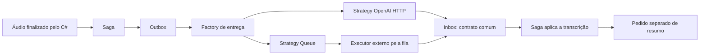

# Transcrição OpenAI no Clínica

Implementação local de 27/10/2026. O Worker existente entrega o pedido à API
OpenAI usando Strategy. Gravação, telas, upload e junção dos chunks pelo C#
permanecem no caminho atual.



## Ponto de troca

`TranscriptionDeliveryFactory` segue o conceito já usado por `NotificationFactory`:
contrato, implementações e seleção explícita por configuração/DI, sem reflection.
A factory é chamada somente pelo processamento da Outbox. A saga continua
publicando `audio.transcribe`, aguardando e aplicando o mesmo resultado.

`OpenAI` é o padrão para novas entregas de transcrição. `Queue` conserva o
executor pela fila, inclusive o protótipo Codex quando configurado. Outras
operações, como `text.summarize`, continuam pela fila. Não há fallback automático.
Não foram criados host, Worker, endpoint, tabela ou serviço intermediário.

O destino fica registrado em `yOutbox.TransportData.DeliveryProvider` antes do
envio; retries mantêm esse destino. Entregas antigas recuperadas de uma reserva
expirada, ou já em retry e ainda sem essa metadata, conservam `Queue`. Pedidos
novos ainda não vinculados usam a configuração vigente na primeira entrega.

## Configuração

O Worker lê `ClinicaTranscription:Provider`, `ApiKey`, `Model`, `BaseUrl` e,
opcionalmente, `FFmpegExecutable`. Padrões: `OpenAI`, `gpt-transcribe`,
`https://api.openai.com/v1` e `ffmpeg`. A chave não está no código ou no Front.

O deploy lê o arquivo geral privado
`/root/YeshuaPrivate/production/credentials.json`, no bloco
`Apps.Clinica.Transcription`, junto das conexões de banco e demais chaves.
O antigo `codex-executor.json` não é lido nem usado como fallback.
Dentro de `Apps.Clinica`, o bloco aceita:

Modelo publico: [clinica-transcription.example.json](../../../infra/private/clinica-transcription.example.json).

```json
{
  "Transcription": {
    "Provider": "OpenAI",
    "ApiKey": "",
    "Model": "gpt-transcribe",
    "BaseUrl": "https://api.openai.com/v1"
  }
}
```

Preservar todos os demais campos do arquivo geral. O exemplo é somente um
fragmento para `Apps.Clinica`, não um segundo arquivo de configuração.
O exportador privado fornece `CLINICA_TRANSCRIPTION_*`; o Compose injeta essas
variáveis somente no Worker para esta integração. Para voltar à fila, usar
`Transcription.Provider = Queue` e manter um consumidor configurado para as
tasks. O resumo continua exigindo esse consumidor mesmo com transcrição OpenAI.
Sem chave, a transcrição falha de forma visível pelo contrato comum de Inbox.

## Áudio e limites do piloto

- O arquivo final já reunido é lido do storage do tenant/upload. A referência
  recebida não autoriza baixar URLs ou ler caminhos arbitrários.
- Formatos reconhecidos de até 24 MB seguem diretamente, por streaming multipart.
  O envio usa a extensão do conteúdo identificado, inclusive MP4 gravado com
  nome `audio.webm`.
- Acima dessa margem, ou com formato não reconhecido, o FFmpeg prepara MP3 mono,
  16 kHz, 64 kbps e partes de dez minutos. As partes são enviadas sequencialmente
  e seus textos reunidos na ordem. Não são os chunks de dez segundos do navegador.
- Limites locais: entrada até 250 MB, até 64 partes, texto até 300 mil caracteres.
  Temporários ficam na área volátil de saída e são removidos ao terminar ou falhar;
  o arquivo original é preservado. O Dockerfile instala FFmpeg somente no Worker.
  A construção confere o binário e o Compose configura `/usr/bin/ffmpeg`.
- Cada entrega HTTP completa, incluindo preparo e partes, tem prazo de 240 segundos,
  menor que a recuperação de reserva de cinco minutos. Sessões longas precisam
  de medição no piloto; não há garantia de completar nesse prazo.

O modelo é executado na OpenAI. O servidor não carrega modelo local de fala.
Formato, multipart e limites do provedor seguem o
[guia oficial de transcrição](https://developers.openai.com/api/docs/guides/speech-to-text)
e a [referência da API](https://developers.openai.com/api/reference/resources/audio/subresources/transcriptions/methods/create).
Para `gpt-transcribe`, o envio informa `languages[]=pt`.

## Entrega, falhas e retomada

HTTP ocorre fora da transação SQL. O retorno é normalizado em
`messageId/requestId/correlationId/status/result/error` e passa pela mesma
validação de Inbox: contrato declarado, saga, step, escopo, tentativa e duplicidade.
Gravar a Inbox e confirmar a Outbox acontece em uma transação curta. Atualizações
conferem a reserva e o escopo, impedindo confirmação por um Worker que perdeu a posse.

Falhas transitórias e timeout reagendam a Outbox, até cinco tentativas, respeitando
`Retry-After`. Falta de crédito, referência inválida e falhas permanentes geram
retorno terminal pela Inbox e dead letter da Outbox, permitindo à saga sair da
espera com falha. Não há segundo ciclo automático de retry do step para esse
erro terminal. Retornos já recebidos evitam novo envio ao provedor.

A entrega é pelo menos uma vez: uma queda após o processamento no provedor e
antes do commit local ainda pode repetir a chamada e o custo. O identificador
estável deduplica a aplicação local; não promete deduplicação na OpenAI.
Logs HTTP usam a borda operacional compartilhada, sem áudio, texto, token ou
corpo de erro do provedor. Identidade causal é preservada nas tentativas.

## Validação e ativação

Testes locais usam HTTP, storage e repositories controlados, exercitando os
handlers reais de Outbox/Inbox. Cobrem sucesso, fila, destino preservado,
duplicidade, pedido obsoleto, retry/429, falta de crédito/chave, contrato inválido,
rollback, perda de reserva e limpeza após falha no preparo.

Evidência local desta implementação:

| Verificação | Resultado |
| --- | --- |
| Entrega OpenAI/fila e fluxo da sessão | 31 testes aprovados |
| Engine, incluindo contratos e geração de Outbox/Inbox | 51 testes aprovados |
| CQRS compartilhado | 37 testes aprovados |
| Exportador privado: fonte geral única, segredo isolado e seleção do provider | 5 testes locais aprovados |
| API e Worker do Clínica | Compilação com sucesso |
| Studio `--codegen-only` e preservação dos fontes de gravação/upload/step | Conferidos |

Total: 124 testes locais. Os resultados .NET estão em `.artifacts/TestResults/clinica-openai*.trx`.
Isso não representa execução com SQL real, OpenAI ou conversão de mídia real.

A publicação na VPS e a prova real do adaptador foram concluídas em 27/10/2026,
conforme o registro abaixo. Ainda falta homologar pela tela atual com áudio real
do navegador, sessão longa e fluxo de resumo. O plano futuro de fechamento
humano está em [PLANO_PAINEL_ATENDIMENTOS.md](PLANO_PAINEL_ATENDIMENTOS.md).

### Publicação e validação em 27/10/2026

Por orientação explícita do usuário, a chave pertence ao arquivo geral
`/root/YeshuaPrivate/production/credentials.json`, no bloco
`Apps.Clinica.Transcription`, junto das conexões de banco e demais chaves.
Arquivo `0600`; campos anteriores comparados e preservados. O leitor usa
somente esse documento. A chave foi retirada do antigo `codex-executor.json`
e do `.env` temporário local; as cópias privadas de recuperação permanecem
na área de operações protegida, sem serem fonte de configuração.

O usuário autorizou usar a chave atual nos testes e renová-la posteriormente.
Nenhum valor de chave consta nesta documentação. A credencial `McpTunnel.ApiKey`
do agente operacional não é uma chave OpenAI e não foi reutilizada.

Publicação `clinica-openai-0bd622c63ced` sobre a base
`c65fe2fa9fde7928aa367fddaa92f4ab91f791f3`, pelo deploy existente do Clínica,
com atualização do Git e deploy Shared desativados. Foram preservados os fontes
e imagens anteriores para recuperação. API e Worker foram substituídos;
os outros containers continuaram com o mesmo tempo de execução.
O build serial usa um processador e limite de heap para conter o consumo de RAM.
A migration existente terminou com código zero. O inventário anterior encontrou
zero sagas e zero pedidos Outbox no banco do Clínica; não houve migração de
pedidos antigos para outro provedor.

| Verificação no servidor | Resultado |
| --- | --- |
| Configuração privada completa em Linux | 24 testes aprovados; 1 de ACL Windows ignorado |
| API e Worker | Docker healthy; live Healthy; ready Ready |
| Worker | Provider OpenAI; modelo gpt-transcribe; chave igual à do arquivo geral |
| API | Não recebe a chave de transcrição |
| FFmpeg do Worker | 5.1.9 instalado e executável |
| Erros nos logs após publicação | Zero marcadores de erro na janela conferida |
| Consumidores de retorno | audio.transcribed.inbox e text.summarized.inbox ativos |

Foi executado um verificador isolado com o adaptador C# da imagem publicada.
Uma voz sintética em português, convertida para AIFF para exercitar o preparo
condicional, passou por FFmpeg e pela API OpenAI. Retornou
`audio.transcription.completed` em aproximadamente 3,5 segundos e o texto:

> Teste de transcrição da clínica. Esta gravação não contém dados de pacientes.

Nenhum áudio de paciente foi usado. Nenhum upload, consulta ou saga de negócio
foi criado pelo verificador. Os diretórios temporários foram limpos. Essa prova
valida o adaptador/FFmpeg/provedor; não substitui um teste completo pela tela.

O resumo continua em uma chamada separada via `text.summarize.outbox`, sem
consumidor no servidor neste momento. Uma consulta pode concluir a transcrição
e permanecer aguardando resumo; o fechamento completo ainda depende desse executor.

Os recibos privados, manifestos dos 64 fontes publicados, testes, identidades
das imagens anteriores e resultados ficam em
`/root/YeshuaPrivate/production/operations/clinica-openai-0bd622c63ced`.
A publicação contém alterações da versão de trabalho ainda sem commit/push.
Antes de executar novamente o deploy habitual que atualiza e limpa o checkout,
versionar essas alterações para não descartá-las. Nenhum commit ou push foi
realizado nesta operação.
