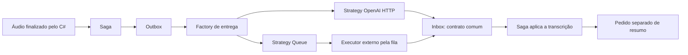

# Transcrição OpenAI no Clínica

Publicado e homologado pela API em 27/10/2026. O Worker existente entrega o pedido à API
OpenAI usando Strategy. Gravação, telas, upload e junção dos chunks pelo C#
permanecem no caminho atual.



## Ponto de troca

`TranscriptionDeliveryFactory` segue o conceito já usado por `NotificationFactory`:
contrato, implementações e seleção explícita por configuração/DI, sem reflection.
A factory é chamada somente pelo processamento da Outbox. A saga continua
publicando `audio.transcribe`, aguardando e aplicando o mesmo resultado.

`OpenAI` é o padrão para novas entregas de transcrição. `Queue` conserva o
executor pela fila, inclusive o protótipo Codex quando configurado. Outras
operações, como `text.summarize`, continuam pela fila. Não há fallback automático.
Não foram criados host, Worker, endpoint, tabela ou serviço intermediário.

O destino fica registrado em `yOutbox.TransportData.DeliveryProvider` antes do
envio; retries mantêm esse destino. Entregas antigas recuperadas de uma reserva
expirada, ou já em retry e ainda sem essa metadata, conservam `Queue`. Pedidos
novos ainda não vinculados usam a configuração vigente na primeira entrega.

## Configuração

O Worker lê `ClinicaTranscription:Provider`, `ApiKey`, `Model`, `BaseUrl` e,
opcionalmente, `FFmpegExecutable`. Padrões: `OpenAI`, `gpt-transcribe`,
`https://api.openai.com/v1` e `ffmpeg`. A chave não está no código ou no Front.

O deploy lê o arquivo geral privado
`/root/YeshuaPrivate/production/credentials.json`, no bloco
`Apps.Clinica.Transcription`, junto das conexões de banco e demais chaves.
O antigo `codex-executor.json` não é lido nem usado como fallback.
Dentro de `Apps.Clinica`, o bloco aceita:

Modelo publico: [clinica-transcription.example.json](../../../infra/private/clinica-transcription.example.json).

```json
{
  "Transcription": {
    "Provider": "OpenAI",
    "ApiKey": "",
    "Model": "gpt-transcribe",
    "BaseUrl": "https://api.openai.com/v1"
  }
}
```

Preservar todos os demais campos do arquivo geral. O exemplo é somente um
fragmento para `Apps.Clinica`, não um segundo arquivo de configuração.
O exportador privado fornece `CLINICA_TRANSCRIPTION_*`; o Compose injeta essas
variáveis somente no Worker para esta integração. Para voltar à fila, usar
`Transcription.Provider = Queue` e manter um consumidor configurado para as
tasks. O resumo continua exigindo esse consumidor mesmo com transcrição OpenAI.
Sem chave, a transcrição falha de forma visível pelo contrato comum de Inbox.

## Groq Whisper Large V3 Turbo — desenvolvimento e testes

A Strategy `GroqTranscriptionDeliveryStrategy` usa o mesmo protocolo multipart,
preparo FFmpeg, limites, resultado versionado e aceitacao de Inbox da OpenAI.
O codigo comum fica no Infrastructure.Shared do Clinica, em
`OpenAICompatibleTranscriptionDeliveryStrategy`; nao muda a Engine nem as sagas.
A [documentacao oficial Groq](https://console.groq.com/docs/speech-to-text)
define o endpoint `/openai/v1/audio/transcriptions`, o modelo
`whisper-large-v3-turbo`, `language=pt` e retorno JSON com `text`.

A selecao explicita `Transcription.Provider = Groq` usa exclusivamente o bloco
`Apps.Clinica.Transcription.Groq` do mesmo arquivo privado por ambiente:

```json
{
  "ApiKey": "",
  "Model": "whisper-large-v3-turbo",
  "BaseUrl": "https://api.groq.com/openai/v1"
}
```

O Worker recebe `ClinicaTranscription:Groq:ApiKey`, `Model` e `BaseUrl`, exportados
como `CLINICA_GROQ_API_KEY`, `CLINICA_GROQ_MODEL` e `CLINICA_GROQ_BASE_URL`.
Esses valores nao substituem o perfil OpenAI existente nem sao enviados ao
executor de resumo. Sem chave Groq, a entrega Groq falha pelo contrato comum,
mesmo quando existe chave OpenAI. O destino `Groq` fica congelado na metadata da
Outbox; uma troca posterior da configuracao nao muda pedidos ja vinculados.
OpenAI continua como padrao, Queue preserva pedidos antigos e resumo continua Queue.

Esta entrega e somente de desenvolvimento: nenhum deploy ou credencial de
producao foi alterado. O teste real depende de credencial de teste disponivel em
ambiente seguro e sandbox isolado, usando somente voz sintetica, sem banco,
fila ou dados de pacientes. Sem essas condicoes, a prova real permanece pendente.
Os testes offline usam chaves ficticias, HTTP/storage/repositories controlados e
os handlers reais de Outbox/Inbox; nao comprovam chamada ao provedor.

### Validacao local da extensao Groq em 15/11/2026

| Verificacao executada | Resultado |
| --- | --- |
| Build do Worker Clinica e dependencias | Sucesso; 0 erros, 174 avisos em fontes existentes |
| `OpenAIOutboxDeliveryTests` e `SessionInsightFlowTests` | 54 aprovados, 0 falhas |
| Credenciais: testes com `clinica` no nome em `test_credentials.py` | 9 aprovados |
| `test_codex_executor.py` | 13 aprovados |
| Resolucao isolada da DI real do Worker para OpenAI/Groq/Queue | Aprovada, sem I/O externo |
| `git diff --check` | Aprovado |
| `test_compose_configuration.py` | 1 ignorado; CLI Docker Compose ausente |
| Suite completa `test_credentials.py` | Nao passou neste sandbox: home somente leitura; redirecionar temporarios ao workspace tambem encontra a guarda que proibe arquivos privados no repositorio |
| API real Groq com voz sintetica | Nao executada: nenhuma credencial Groq nas variaveis verificadas nem arquivo privado de testes selecionado |

O fixture novo de ausencia de perfil foi corrigido apos a primeira execucao:
o helper `configured()` preenche todas as chaves vazias do exemplo com valores
ficticios; o teste agora remove explicitamente o perfil Groq para testar sua ausencia.
Os nove testes focados passaram depois dessa correcao. As restricoes de caminho
na suite completa nao foram contornadas nem alteradas na implementacao.

Comandos .NET usados (a partir da raiz):

```sh
dotnet build src/CQRS/Infrastructure/Yeshua.Clinica.CQRS.Infrastructure.Worker/Yeshua.Clinica.CQRS.Infrastructure.Worker.csproj --nologo -v quiet
dotnet test tests/CQRS/Yeshua.Clinica.CQRS.Tests.Integration.Api.Smoke/Yeshua.Clinica.CQRS.Tests.Integration.Api.Smoke.csproj --no-restore --filter 'FullyQualifiedName~OpenAIOutboxDeliveryTests|FullyQualifiedName~SessionInsightFlowTests' --nologo -v quiet --logger 'trx;LogFileName=clinica-groq-offline.trx' --results-directory /tmp/clinica-groq-test-results
```

O TRX desta sessao fica em `/tmp/clinica-groq-test-results/clinica-groq-offline.trx`.
O verificador temporario de DI referencia o projeto Worker real e usa
`WebApplication.CreateEmptyBuilder` com configuracao em memoria e chaves ficticias;
nao carrega configuracao de producao nem inicia o host. Os testes Python focados
foram selecionados via `unittest.TestLoader` em `CredentialsTests`, por nome
contendo `clinica`. O executor foi validado por
`python3 -m unittest discover -s tests/Media/Clinica -p 'test_codex_executor.py'`.
Nenhuma dessas provas substitui homologacao com SQL, broker e API real Groq.

O smoke externo `GroqConnectionTests` valida autenticacao, conectividade e a
disponibilidade do modelo configurado pelo endpoint oficial `GET /models`. Ele e
ignorado automaticamente quando `CLINICA_GROQ_API_KEY` nao esta definida, para
nao tornar a suite normal dependente de rede ou segredo. A chave nunca e gravada
no repositorio nem incluida nas mensagens de falha. Em PowerShell, a execucao
isolada e:

```powershell
$env:CLINICA_GROQ_API_KEY = "<chave somente nesta sessao>"
dotnet test tests/CQRS/Yeshua.Clinica.CQRS.Tests.Integration.Api.Smoke/Yeshua.Clinica.CQRS.Tests.Integration.Api.Smoke.csproj --filter "FullyQualifiedName~GroqConnectionTests" --nologo
Remove-Item Env:CLINICA_GROQ_API_KEY
```

`CLINICA_GROQ_MODEL` e `CLINICA_GROQ_BASE_URL` sao opcionais e assumem os
mesmos padroes do Worker. Esse smoke nao envia audio e, portanto, deve ser lido
junto dos testes HTTP controlados da Strategy, que validam o multipart de
transcricao sem custo externo.

Arquivos desta entrega (caminhos relativos ao repositorio):

- `src/CQRS/Infrastructure/Yeshua.Clinica.CQRS.Infrastructure.Shared/Patterns/Strategy/Custon/OutboxDelivery/GroqTranscriptionDeliveryStrategy.cs` (novo).
- `src/CQRS/Infrastructure/Yeshua.Clinica.CQRS.Infrastructure.Shared/Patterns/Strategy/Custon/OutboxDelivery/OpenAICompatibleTranscriptionDeliveryStrategy.cs` (extracao do protocolo existente).
- `src/CQRS/Infrastructure/Yeshua.Clinica.CQRS.Infrastructure.Shared/Patterns/Strategy/Custon/OutboxDelivery/OpenAITranscriptionDeliveryStrategy.cs`.
- `src/CQRS/Infrastructure/Yeshua.Clinica.CQRS.Infrastructure.Shared/Patterns/Strategy/Custon/OutboxDelivery/TranscriptionDeliveryFactory.cs` (inclui options).
- `src/CQRS/Infrastructure/Yeshua.Clinica.CQRS.Infrastructure.Worker/Custon/DependencInjection.cs`.
- `infra/private/credentials.py`.
- `infra/private/credentials.example.json`.
- `infra/private/clinica-transcription.example.json`.
- `infra/private/README.md`.
- `infra/Clinica/DockerCompose/docker-compose.yml`.
- `tests/CQRS/Yeshua.Clinica.CQRS.Tests.Integration.Api.Smoke/Custon/Saga/PsychologySessionInsight/OpenAIOutboxDeliveryTests.cs`.
- `tests/Infrastructure/PrivateConfig/test_credentials.py`.
- `docs/operational/clinica/OPENAI_TRANSCRIPTION.md`.
- `AGENTS.md`.

Nenhum commit, push, merge ou deploy foi executado nesta tarefa. O aplicativo
que gerencia a task fica responsavel pelo commit/envio/PR em rascunho.

## Áudio e limites do piloto

- O arquivo final já reunido é lido do storage do tenant/upload. A referência
  recebida não autoriza baixar URLs ou ler caminhos arbitrários.
- Formatos reconhecidos de até 24 MB seguem diretamente, por streaming multipart.
  O envio usa a extensão do conteúdo identificado, inclusive MP4 gravado com
  nome `audio.webm`.
- Acima dessa margem, ou com formato não reconhecido, o FFmpeg prepara MP3 mono,
  16 kHz, 64 kbps e partes de dez minutos. As partes são enviadas sequencialmente
  e seus textos reunidos na ordem. Não são os chunks de dez segundos do navegador.
- Limites locais: entrada até 250 MB, até 64 partes, texto até 300 mil caracteres.
  Temporários ficam na área volátil de saída e são removidos ao terminar ou falhar;
  o arquivo original é preservado. O Dockerfile instala FFmpeg somente no Worker.
  A construção confere o binário e o Compose configura `/usr/bin/ffmpeg`.
- Cada entrega HTTP completa, incluindo preparo e partes, tem prazo de 240 segundos,
  menor que a recuperação de reserva de cinco minutos. Sessões longas precisam
  de medição no piloto; não há garantia de completar nesse prazo.

O modelo é executado na OpenAI. O servidor não carrega modelo local de fala.
Formato, multipart e limites do provedor seguem o
[guia oficial de transcrição](https://developers.openai.com/api/docs/guides/speech-to-text)
e a [referência da API](https://developers.openai.com/api/reference/resources/audio/subresources/transcriptions/methods/create).
Para `gpt-transcribe`, o envio informa `languages[]=pt`.

## Entrega, falhas e retomada

HTTP ocorre fora da transação SQL. O retorno é normalizado em
`messageId/requestId/correlationId/status/result/error` e passa pela mesma
validação de Inbox: contrato declarado, saga, step, escopo, tentativa e duplicidade.
Gravar a Inbox e confirmar a Outbox acontece em uma transação curta. Atualizações
conferem a reserva e o escopo, impedindo confirmação por um Worker que perdeu a posse.

Falhas transitórias e timeout reagendam a Outbox, até cinco tentativas, respeitando
`Retry-After`. Falta de crédito, referência inválida e falhas permanentes geram
retorno terminal pela Inbox e dead letter da Outbox, permitindo à saga sair da
espera com falha. Não há segundo ciclo automático de retry do step para esse
erro terminal. Retornos já recebidos evitam novo envio ao provedor.

A entrega é pelo menos uma vez: uma queda após o processamento no provedor e
antes do commit local ainda pode repetir a chamada e o custo. O identificador
estável deduplica a aplicação local; não promete deduplicação na OpenAI.
Logs HTTP usam a borda operacional compartilhada, sem áudio, texto, token ou
corpo de erro do provedor. Identidade causal é preservada nas tentativas.

## Validação e ativação

Testes locais usam HTTP, storage e repositories controlados, exercitando os
handlers reais de Outbox/Inbox. Cobrem sucesso, fila, destino preservado,
duplicidade, pedido obsoleto, retry/429, falta de crédito/chave, contrato inválido,
rollback, perda de reserva e limpeza após falha no preparo.

Evidência local desta implementação:

| Verificação | Resultado |
| --- | --- |
| Entrega OpenAI/fila e fluxo da sessão | 31 testes aprovados |
| Engine, incluindo contratos e geração de Outbox/Inbox | 51 testes aprovados |
| CQRS compartilhado | 37 testes aprovados |
| Exportador privado: fonte geral única, segredo isolado e seleção do provider | 6 testes focados aprovados |
| API e Worker do Clínica | Compilação com sucesso |
| Studio `--codegen-only` e preservação dos fontes de gravação/upload/step | Conferidos |

As três suítes .NET somam 119 testes; a configuração focada soma outros 6. Os resultados .NET estão em `.artifacts/TestResults/clinica-openai*.trx`.
Isso não representa execução com SQL real, OpenAI ou conversão de mídia real.

A publicação na VPS e a homologação integrada pela API foram concluídas em
27/10/2026, conforme os registros abaixo. Permanecem como ensaios adicionais
a gravação por microfone na tela e sessões longas de áudio. O plano futuro de fechamento
humano está em [PLANO_PAINEL_ATENDIMENTOS.md](PLANO_PAINEL_ATENDIMENTOS.md).

### Publicação e validação em 27/10/2026

Por orientação explícita do usuário, a chave pertence ao arquivo geral
`/root/YeshuaPrivate/production/credentials.json`, no bloco
`Apps.Clinica.Transcription`, junto das conexões de banco e demais chaves.
Arquivo `0600`; campos anteriores comparados e preservados. O leitor usa
somente esse documento. A chave foi retirada do antigo `codex-executor.json`
e do `.env` temporário local; as cópias privadas de recuperação permanecem
na área de operações protegida, sem serem fonte de configuração.

O usuário autorizou usar a chave atual nos testes e renová-la posteriormente.
Nenhum valor de chave consta nesta documentação. A credencial `McpTunnel.ApiKey`
do agente operacional não é uma chave OpenAI e não foi reutilizada.

Publicação `clinica-openai-0bd622c63ced` sobre a base
`c65fe2fa9fde7928aa367fddaa92f4ab91f791f3`, pelo deploy existente do Clínica,
com atualização do Git e deploy Shared desativados. Foram preservados os fontes
e imagens anteriores para recuperação. API e Worker foram substituídos;
os outros containers continuaram com o mesmo tempo de execução.
O build serial usa um processador e limite de heap para conter o consumo de RAM.
A migration existente terminou com código zero. O inventário anterior encontrou
zero sagas e zero pedidos Outbox no banco do Clínica; não houve migração de
pedidos antigos para outro provedor.

| Verificação no servidor | Resultado |
| --- | --- |
| Configuração privada completa em Linux | 24 testes aprovados; 1 de ACL Windows ignorado |
| API e Worker | Docker healthy; live Healthy; ready Ready |
| Worker | Provider OpenAI; modelo gpt-transcribe; chave igual à do arquivo geral |
| API | Não recebe a chave de transcrição |
| FFmpeg do Worker | 5.1.9 instalado e executável |
| Erros nos logs após publicação | Zero marcadores de erro na janela conferida |
| Consumidores de retorno | audio.transcribed.inbox e text.summarized.inbox ativos |

Foi executado um verificador isolado com o adaptador C# da imagem publicada.
Uma voz sintética em português, convertida para AIFF para exercitar o preparo
condicional, passou por FFmpeg e pela API OpenAI. Retornou
`audio.transcription.completed` em aproximadamente 3,5 segundos e o texto:

> Teste de transcrição da clínica. Esta gravação não contém dados de pacientes.

Nenhum áudio de paciente foi usado. Nenhum upload, consulta ou saga de negócio
foi criado pelo verificador. Os diretórios temporários foram limpos. Essa prova
valida o adaptador/FFmpeg/provedor; não substitui um teste completo pela tela.

### Homologação integrada e resumo separado

O consumidor de `text.summarize.outbox` foi habilitado por
`Apps.Clinica.Codex.Enabled = true` no arquivo geral, com scope `production`.
Ele roda no serviço `operational-intelligence` existente, preservando sua API,
MCP e autenticação Codex. Nenhum novo container de aplicação foi criado.
A transcrição continua OpenAI HTTP no Worker C#, sem passar pelo Codex.

A primeira tentativa completa comprovou a transcrição e revelou uma falha no
resumo: `/storage` é root:root `0750` na VPS. A pasta temporária foi montada em
`/clinica-work/volatile/ia/transcriptions/output`, com `STORAGE_ROOT=/clinica-work`.
O original continua somente leitura e suas permissões não foram ampliadas.
O teste de regressão do Compose e a prova de escrita na pasta isolada passaram.

A saga sintética 1 foi retomada pelo Command público normal de retry, apenas
no step de resumo. Terminou em cerca de 13,1 s. O step de transcrição conservou
`ExecutionCount=1`; o resumo concluiu na tentativa 4, após as três falhas de
permissão. Isso comprovou a retomada sem repetir a transcrição.

Em seguida, uma segunda consulta sintética confirmou o caminho de sucesso:

- Login na Central, abertura da sessão do Clínica por `getMenu` e uso do token
  de aplicação, como faz a tela.
- WebM com fala fictícia enviado em três chunks; repetição do último devolveu
  a mesma saga.
- Saga -> Outbox -> OpenAI -> Inbox -> transcrição persistida.
- Outro pedido Outbox -> RabbitMQ -> Codex -> Inbox -> resumo persistido.
- Saga 2 com status 2, ambos os steps com status 5 e exatamente duas Outboxes.
- `StatusProntuario=3`; Prontuario, QueixaPrincipal e RegistroDocumental
  preenchidos com os fatos da gravação, sem acrescentar diagnóstico ou medicação.

O teste .NET real passou em 24 s de execução (41,2 s incluindo preparação/build).
Resultado: `.artifacts/TestResults/clinica-real-homologation.trx`. A gravação de
homologação tem apenas personagens fictícios; nenhum áudio de paciente foi usado.
As duas consultas sintéticas foram excluídas logicamente pela API normal depois
da conferência dos resultados; as sagas e os recibos técnicos foram preservados.
A prova percorre os endpoints reais de upload e a junção C#, sem automatizar
captura de microfone no navegador.

O `401` inicial vinha do perfil de teste apontando para o login legado do
Clínica, enquanto a senha guardada pertencia à Central. A autenticação correta é
`/apps/central/yapi/login`, seguida de `/apps/clinica/yapi/getMenu`, que fornece
`X-Yeshua-Application-Token`. Nenhuma senha foi trocada para realizar o teste.

| Suíte desta publicação | Resultado |
| --- | --- |
| Fluxo/Strategy do Clínica | 31 aprovados |
| Engine | 51 aprovados |
| CQRS compartilhado | 37 aprovados |
| Executor Python | 13 aprovados |
| Leitor de credenciais completo em Linux | 28 aprovados; 1 de ACL Windows ignorado |
| Ambiente operacional Node | 17 aprovados |
| Saga real com SQL, RabbitMQ, OpenAI e Codex | 1 aprovado |

Os recibos privados, fontes/imagens anteriores, testes e manifestos ficam em
`/root/YeshuaPrivate/production/operations/clinica-openai-0bd622c63ced`.
O núcleo foi versionado em `0ee995a424101d86856ae121f0f6c6b3798447d8` e enviado
à branch `codex/clinica-openai-transcription`. Esta revisão também versiona o
ajuste do mount, o smoke de três chunks e o registro da homologação para entrega
na `main`. Chaves e artefatos privados permanecem fora do Git e do build Docker.
