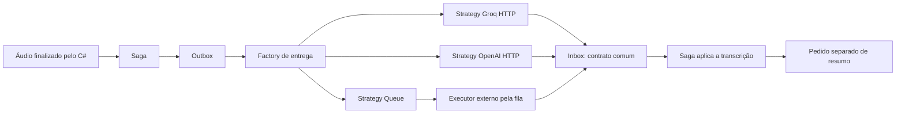

# Transcrição OpenAI e Groq no Clínica

Publicado e homologado pela API em 27/10/2026. O Worker existente entrega o pedido à API
OpenAI usando Strategy. Gravação, telas, upload e junção dos chunks pelo C#
permanecem no caminho atual.



## Ponto de troca

`TranscriptionDeliveryFactory` segue o conceito já usado por `NotificationFactory`:
contrato, implementações e seleção explícita por configuração/DI, sem reflection.
A factory é chamada somente pelo processamento da Outbox. A saga continua
publicando `audio.transcribe`, aguardando e aplicando o mesmo resultado.

`OpenAI` continua sendo o padrão para novas entregas de transcrição. `Groq` é
um provedor adicional selecionado globalmente na configuração da Clínica, sem
seleção por tenant. `Queue` conserva o
executor pela fila, inclusive o protótipo Codex quando configurado. Outras
operações, como `text.summarize`, continuam pela fila. Não há fallback automático.
Não foram criados host, Worker, endpoint, tabela ou serviço intermediário.

O destino fica registrado em `yOutbox.TransportData.DeliveryProvider` antes do
envio; retries mantêm esse destino. Entregas antigas recuperadas de uma reserva
expirada, ou já em retry e ainda sem essa metadata, conservam `Queue`. Pedidos
novos ainda não vinculados usam a configuração vigente na primeira entrega.

## Configuração

O Worker lê `ClinicaTranscription:Provider`, `ApiKey`, `Model`, `BaseUrl`,
`Groq:ApiKey`, `Groq:Model`, `Groq:BaseUrl` e,
opcionalmente, `FFmpegExecutable`. Padrões: `OpenAI`, `gpt-transcribe`,
`https://api.openai.com/v1` e `ffmpeg`. A chave não está no código ou no Front.

O deploy lê o arquivo geral privado
`/root/YeshuaPrivate/production/credentials.json`, no bloco
`Apps.Clinica.Transcription`, junto das conexões de banco e demais chaves.
O antigo `codex-executor.json` não é lido nem usado como fallback.
Dentro de `Apps.Clinica`, o bloco aceita:

Modelo publico: [clinica-transcription.example.json](../../../infra/private/clinica-transcription.example.json).

```json
{
  "Transcription": {
    "Provider": "OpenAI",
    "ApiKey": "",
    "Model": "gpt-transcribe",
    "BaseUrl": "https://api.openai.com/v1",
    "Groq": {
      "ApiKey": "",
      "Model": "whisper-large-v3-turbo",
      "BaseUrl": "https://api.groq.com/openai/v1"
    }
  }
}
```

Preservar todos os demais campos do arquivo geral. O exemplo é somente um
fragmento para `Apps.Clinica`, não um segundo arquivo de configuração.
O exportador privado fornece `CLINICA_TRANSCRIPTION_*`; o Compose injeta essas
variáveis somente no Worker para esta integração. Para voltar à fila, usar
`Transcription.Provider = Queue` e manter um consumidor configurado para as
tasks. O resumo continua exigindo esse consumidor mesmo com transcrição OpenAI.
Sem chave, a transcrição falha de forma visível pelo contrato comum de Inbox.
Para Groq, preencher `Transcription.Groq.ApiKey` pelo mecanismo privado e, somente
após autorização de ativação, trocar `Transcription.Provider` para `Groq`.
`ApiKey/Model/BaseUrl` na raiz de `Transcription` continuam pertencendo à OpenAI;
nunca copiar uma chave de provedor para o outro. Preservar ambas as credenciais
enquanto houver entregas vinculadas aos respectivos provedores. O rollback da
seleção global afeta pedidos novos, sem redirecionar retries já vinculados.

## Áudio e limites do piloto

- O arquivo final já reunido é lido do storage do tenant/upload. A referência
  recebida não autoriza baixar URLs ou ler caminhos arbitrários.
- Para OpenAI, formatos reconhecidos de até 24 MB seguem diretamente, por streaming multipart.
  O envio usa a extensão do conteúdo identificado, inclusive MP4 gravado com
  nome `audio.webm`.
- Para OpenAI acima dessa margem, ou com formato não reconhecido, o FFmpeg prepara MP3 mono,
  16 kHz, 64 kbps e partes de dez minutos. As partes são enviadas sequencialmente
  e seus textos reunidos na ordem. Não são os chunks de dez segundos do navegador.
- Limites locais: entrada até 250 MB, até 64 partes, texto até 300 mil caracteres.
  Temporários ficam na área volátil de saída e são removidos ao terminar ou falhar;
  o arquivo original é preservado. O Dockerfile instala FFmpeg somente no Worker.
  A construção confere o binário e o Compose configura `/usr/bin/ffmpeg`.
- Cada entrega HTTP completa, incluindo preparo e partes, tem prazo de 240 segundos,
  menor que a recuperação de reserva de cinco minutos. Sessões longas precisam
  de medição no piloto; não há garantia de completar nesse prazo.

No destino OpenAI, o modelo é executado na OpenAI. O servidor não carrega modelo local de fala.
Formato, multipart e limites do provedor seguem o
[guia oficial de transcrição](https://developers.openai.com/api/docs/guides/speech-to-text)
e a [referência da API](https://developers.openai.com/api/reference/resources/audio/subresources/transcriptions/methods/create).
Para `gpt-transcribe`, o envio informa `languages[]=pt`.

## Groq: limites e áudio longo

O adaptador adicional usa `POST /audio/transcriptions`, Bearer e multipart com
`file`, `model=whisper-large-v3-turbo` e `language=pt`, na base
`https://api.groq.com/openai/v1`. Reutiliza o preparo FFmpeg e o contrato de retorno
existentes; não altera a gravação nem o resumo pela fila.

Limites documentados conferidos em 15/11/2026: upload de até **25 MB no Free**
(100 MB no Developer); não há um teto único de duração publicado nesse guia.
O envio para Groq passa pelo preparo existente em segmentos de dez minutos,
MP3 mono de 16 kHz a 64 kbps: aproximadamente 4,8 MB por segmento. A duração
é limitada por segmento e pelas cotas de segundos da organização, não por uma
suposta garantia de uma hora por requisição. Uma gravação de cerca de uma hora
gera aproximadamente seis segmentos sequenciais, preservando a ordem do texto.
Ver [Speech to Text da Groq](https://console.groq.com/docs/speech-to-text) e
[referência da API](https://console.groq.com/docs/api-reference#audio).

O Free publica 20 requisições/minuto, 2.000/dia, 7.200 segundos de áudio/hora e
28.800/dia para esse modelo. Os limites são compartilhados pela organização;
uma sessão de uma hora consome cerca de 3.600 segundos, e uma repetição integral
pode consumir esse volume novamente. Outros consumidores reduzem a disponibilidade.
A conta pode ter limites diferentes: conferir sua página privada Limits antes
de ativar. Não há reserva local de quota nem promessa de capacidade clínica no
Free. `429` segue o retry de Outbox com `Retry-After` limitado a 1–300 segundos
pelo adaptador existente; não trocar provedor ao
atingir quota. Ver [Rate Limits da Groq](https://console.groq.com/docs/rate-limits).

O prazo total continua 240 segundos e as tentativas continuam limitadas: uma
indisponibilidade ou quota diária pode terminar em falha visível, exigindo retry
manual pelo caminho já existente após recuperar a capacidade. Uma falha após
segmentos concluídos pode repetir esses segmentos e seu consumo. Nenhum scheduler,
checkpoint ou controlador de quota paralelo foi criado. `401/403` e chave ausente
são falhas terminais; timeout e falhas transitórias seguem a política existente.

## Catálogo operacional e aplicação da configuração

Todos os campos abaixo pertencem ao arquivo privado único, sob
`Apps.Clinica.Transcription`. Não há hot reload desse arquivo no Worker.

| Campo / exportação | Finalidade / serviço | Aplicação | Validação | Reversão |
| --- | --- | --- | --- | --- |
| `Provider` → `CLINICA_TRANSCRIPTION_PROVIDER` → `ClinicaTranscription__Provider` | Seleção global na Factory / `clinica-worker` | Recriar Worker após carregar exportação; primeiro uso do novo código exige deploy | Nova entrega usa destino esperado; retry conserva `TransportData.DeliveryProvider` | Restaurar `OpenAI` (ou `Queue`, com consumidor) e recriar Worker |
| `ApiKey/Model/BaseUrl` → `CLINICA_TRANSCRIPTION_API_KEY/MODEL/BASE_URL` → `ClinicaTranscription__ApiKey/Model/BaseUrl` | Credencial e endpoint OpenAI / Worker | Recriação | Áudio fictício, Inbox comum e autenticação; jamais imprimir chave | Restaurar valores privados anteriores e recriar |
| `Groq.ApiKey/Model/BaseUrl` → `CLINICA_TRANSCRIPTION_GROQ_API_KEY/MODEL/BASE_URL` → `ClinicaTranscription__Groq__ApiKey/Model/BaseUrl` | Credencial e endpoint Groq / Worker | Recriação | Áudio fictício e destino Groq; quotas na conta | Restaurar valores privados anteriores; preservar credencial de pedidos Groq pendentes |
| `ClinicaTranscription__FFmpegExecutable=/usr/bin/ffmpeg` (Compose) | Preparo de áudio / Worker | Recriar se mudar caminho; alterar binário exige imagem/deploy | Binário executável e conversão fictícia | Restaurar caminho/imagem anterior |

Caminho conferido: `infra/Clinica/DockerCompose/deploy.sh` carrega
`infra/docker/load-deploy-env.sh clinica`; o loader chama `credentials.py export`,
decodifica em memória e exporta `CLINICA_TRANSCRIPTION_*`. O Compose interpola
essas variáveis somente no Worker. O JSON privado não é montado nos containers.
**`docker restart` não atualiza environment**. É necessário recarregar o loader e
recriar o container. Não executar `credentials.py export`, `env`, `docker inspect`
ou `docker compose config` sem `--quiet` em terminal registrado: podem revelar
segredos. Não usar `set -x`.

Após disponibilizar a imagem revisada e obter autorização operacional, validar
sem imprimir valores:

```bash
python3 infra/private/credentials.py validate --target clinica
```

Para aplicar somente configuração com a imagem revisada já instalada, em uma
sessão administrativa privada no host e na raiz do repositório:

```bash
APP_DIR="$PWD"
source infra/docker/load-deploy-env.sh clinica
docker compose -f infra/Clinica/DockerCompose/docker-compose.yml config --quiet
docker compose -f infra/Clinica/DockerCompose/docker-compose.yml up -d --no-deps --force-recreate clinica-worker
```

Esses comandos são roteiro para execução autorizada futura, não evidência de
deploy nesta tarefa. Nenhuma migration de banco é necessária para o provedor.
Para rollback sem recompilar, restaurar `Provider=OpenAI`, conservar os dados
OpenAI anteriores, validar, recarregar e repetir a recriação do Worker. Não editar
`DeliveryProvider` de pedidos existentes: eles precisam concluir ou falhar pelo
provedor original, inclusive após rollback. Validar health, uma transcrição
fictícia, Inbox e continuidade para resumo; conferir erros sanitizados e
identidades sem abrir áudio ou texto clínico em logs.

A leitura de `/root/YeshuaPrivate/production/credentials.json` nesta tarefa foi
impedida por permissão do ambiente de desenvolvimento. A presença/validade da
chave Groq não pôde ser confirmada; integração real permanece bloqueada até
verificação privada autorizada. Isso não comprova chave ausente. Não solicitar
nem enviar segredo pelo chat. Testes mockados não substituem essa prova real.

## Verificação local da extensão Groq (15/11/2026)

- `dotnet test tests/CQRS/Yeshua.Clinica.CQRS.Tests.Integration.Api.Smoke --no-restore --filter 'FullyQualifiedName~Custon.Saga' --verbosity quiet`: 45 aprovados, zero falhas.
- Inclui HTTP mockado Groq, multipart/autenticação, erros 401/403/408/429/503,
  quota terminal, timeout/rede, ausência de chave sem fallback, destino persistido
  em ambas as trocas OpenAI/Groq e resumo pela fila. O FFmpeg real processou uma
  hora de tom sintético em partes, com limpeza de temporários.
- `dotnet build src/CQRS/Infrastructure/Yeshua.Clinica.CQRS.Infrastructure.Worker --verbosity quiet`: aprovado, zero avisos/erros após restore.
- `python3 -m unittest discover -s tests/Infrastructure/PrivateConfig -p test_credentials.py -k clinica`: 8 aprovados.
- A suíte PrivateConfig completa teve 34 aprovados, 7 ignorados e 25 erros de
  permissão ao criar temporários em `/home/agent`, somente leitura neste ambiente.
  Docker Compose CLI indisponível; a validação do Compose ficou pendente.
- `git diff --check`: aprovado. Nenhum deploy ou teste com áudio clínico real.
  A integração HTTP real Groq está bloqueada pela leitura privada descrita acima.

## Entrega, falhas e retomada

HTTP ocorre fora da transação SQL. O retorno é normalizado em
`messageId/requestId/correlationId/status/result/error` e passa pela mesma
validação de Inbox: contrato declarado, saga, step, escopo, tentativa e duplicidade.
Gravar a Inbox e confirmar a Outbox acontece em uma transação curta. Atualizações
conferem a reserva e o escopo, impedindo confirmação por um Worker que perdeu a posse.

Falhas transitórias e timeout reagendam a Outbox, até cinco tentativas, respeitando
`Retry-After`. Falta de crédito, referência inválida e falhas permanentes geram
retorno terminal pela Inbox e dead letter da Outbox, permitindo à saga sair da
espera com falha. Não há segundo ciclo automático de retry do step para esse
erro terminal. Retornos já recebidos evitam novo envio ao provedor.

A entrega é pelo menos uma vez: uma queda após o processamento no provedor e
antes do commit local ainda pode repetir a chamada e o custo. O identificador
estável deduplica a aplicação local; não promete deduplicação na OpenAI ou Groq.
Logs HTTP usam a borda operacional compartilhada, sem áudio, texto, token ou
corpo de erro do provedor. Identidade causal é preservada nas tentativas.

## Validação e ativação

Testes locais usam HTTP, storage e repositories controlados, exercitando os
handlers reais de Outbox/Inbox. Cobrem sucesso, fila, destino preservado,
duplicidade, pedido obsoleto, retry/429, falta de crédito/chave, contrato inválido,
rollback, perda de reserva e limpeza após falha no preparo.

Evidência local desta implementação:

| Verificação | Resultado |
| --- | --- |
| Entrega OpenAI/fila e fluxo da sessão | 31 testes aprovados |
| Engine, incluindo contratos e geração de Outbox/Inbox | 51 testes aprovados |
| CQRS compartilhado | 37 testes aprovados |
| Exportador privado: fonte geral única, segredo isolado e seleção do provider | 6 testes focados aprovados |
| API e Worker do Clínica | Compilação com sucesso |
| Studio `--codegen-only` e preservação dos fontes de gravação/upload/step | Conferidos |

As três suítes .NET somam 119 testes; a configuração focada soma outros 6. Os resultados .NET estão em `.artifacts/TestResults/clinica-openai*.trx`.
Isso não representa execução com SQL real, OpenAI ou conversão de mídia real.

A publicação na VPS e a homologação integrada pela API foram concluídas em
27/10/2026, conforme os registros abaixo. Permanecem como ensaios adicionais
a gravação por microfone na tela e sessões longas de áudio. O plano futuro de fechamento
humano está em [PLANO_PAINEL_ATENDIMENTOS.md](PLANO_PAINEL_ATENDIMENTOS.md).

### Publicação e validação em 27/10/2026

Por orientação explícita do usuário, a chave pertence ao arquivo geral
`/root/YeshuaPrivate/production/credentials.json`, no bloco
`Apps.Clinica.Transcription`, junto das conexões de banco e demais chaves.
Arquivo `0600`; campos anteriores comparados e preservados. O leitor usa
somente esse documento. A chave foi retirada do antigo `codex-executor.json`
e do `.env` temporário local; as cópias privadas de recuperação permanecem
na área de operações protegida, sem serem fonte de configuração.

O usuário autorizou usar a chave atual nos testes e renová-la posteriormente.
Nenhum valor de chave consta nesta documentação. A credencial `McpTunnel.ApiKey`
do agente operacional não é uma chave OpenAI e não foi reutilizada.

Publicação `clinica-openai-0bd622c63ced` sobre a base
`c65fe2fa9fde7928aa367fddaa92f4ab91f791f3`, pelo deploy existente do Clínica,
com atualização do Git e deploy Shared desativados. Foram preservados os fontes
e imagens anteriores para recuperação. API e Worker foram substituídos;
os outros containers continuaram com o mesmo tempo de execução.
O build serial usa um processador e limite de heap para conter o consumo de RAM.
A migration existente terminou com código zero. O inventário anterior encontrou
zero sagas e zero pedidos Outbox no banco do Clínica; não houve migração de
pedidos antigos para outro provedor.

| Verificação no servidor | Resultado |
| --- | --- |
| Configuração privada completa em Linux | 24 testes aprovados; 1 de ACL Windows ignorado |
| API e Worker | Docker healthy; live Healthy; ready Ready |
| Worker | Provider OpenAI; modelo gpt-transcribe; chave igual à do arquivo geral |
| API | Não recebe a chave de transcrição |
| FFmpeg do Worker | 5.1.9 instalado e executável |
| Erros nos logs após publicação | Zero marcadores de erro na janela conferida |
| Consumidores de retorno | audio.transcribed.inbox e text.summarized.inbox ativos |

Foi executado um verificador isolado com o adaptador C# da imagem publicada.
Uma voz sintética em português, convertida para AIFF para exercitar o preparo
condicional, passou por FFmpeg e pela API OpenAI. Retornou
`audio.transcription.completed` em aproximadamente 3,5 segundos e o texto:

> Teste de transcrição da clínica. Esta gravação não contém dados de pacientes.

Nenhum áudio de paciente foi usado. Nenhum upload, consulta ou saga de negócio
foi criado pelo verificador. Os diretórios temporários foram limpos. Essa prova
valida o adaptador/FFmpeg/provedor; não substitui um teste completo pela tela.

### Homologação integrada e resumo separado

O consumidor de `text.summarize.outbox` foi habilitado por
`Apps.Clinica.Codex.Enabled = true` no arquivo geral, com scope `production`.
Ele roda no serviço `operational-intelligence` existente, preservando sua API,
MCP e autenticação Codex. Nenhum novo container de aplicação foi criado.
A transcrição continua OpenAI HTTP no Worker C#, sem passar pelo Codex.

A primeira tentativa completa comprovou a transcrição e revelou uma falha no
resumo: `/storage` é root:root `0750` na VPS. A pasta temporária foi montada em
`/clinica-work/volatile/ia/transcriptions/output`, com `STORAGE_ROOT=/clinica-work`.
O original continua somente leitura e suas permissões não foram ampliadas.
O teste de regressão do Compose e a prova de escrita na pasta isolada passaram.

A saga sintética 1 foi retomada pelo Command público normal de retry, apenas
no step de resumo. Terminou em cerca de 13,1 s. O step de transcrição conservou
`ExecutionCount=1`; o resumo concluiu na tentativa 4, após as três falhas de
permissão. Isso comprovou a retomada sem repetir a transcrição.

Em seguida, uma segunda consulta sintética confirmou o caminho de sucesso:

- Login na Central, abertura da sessão do Clínica por `getMenu` e uso do token
  de aplicação, como faz a tela.
- WebM com fala fictícia enviado em três chunks; repetição do último devolveu
  a mesma saga.
- Saga -> Outbox -> OpenAI -> Inbox -> transcrição persistida.
- Outro pedido Outbox -> RabbitMQ -> Codex -> Inbox -> resumo persistido.
- Saga 2 com status 2, ambos os steps com status 5 e exatamente duas Outboxes.
- `StatusProntuario=3`; Prontuario, QueixaPrincipal e RegistroDocumental
  preenchidos com os fatos da gravação, sem acrescentar diagnóstico ou medicação.

O teste .NET real passou em 24 s de execução (41,2 s incluindo preparação/build).
Resultado: `.artifacts/TestResults/clinica-real-homologation.trx`. A gravação de
homologação tem apenas personagens fictícios; nenhum áudio de paciente foi usado.
As duas consultas sintéticas foram excluídas logicamente pela API normal depois
da conferência dos resultados; as sagas e os recibos técnicos foram preservados.
A prova percorre os endpoints reais de upload e a junção C#, sem automatizar
captura de microfone no navegador.

O `401` inicial vinha do perfil de teste apontando para o login legado do
Clínica, enquanto a senha guardada pertencia à Central. A autenticação correta é
`/apps/central/yapi/login`, seguida de `/apps/clinica/yapi/getMenu`, que fornece
`X-Yeshua-Application-Token`. Nenhuma senha foi trocada para realizar o teste.

| Suíte desta publicação | Resultado |
| --- | --- |
| Fluxo/Strategy do Clínica | 31 aprovados |
| Engine | 51 aprovados |
| CQRS compartilhado | 37 aprovados |
| Executor Python | 13 aprovados |
| Leitor de credenciais completo em Linux | 28 aprovados; 1 de ACL Windows ignorado |
| Ambiente operacional Node | 17 aprovados |
| Saga real com SQL, RabbitMQ, OpenAI e Codex | 1 aprovado |

Os recibos privados, fontes/imagens anteriores, testes e manifestos ficam em
`/root/YeshuaPrivate/production/operations/clinica-openai-0bd622c63ced`.
O núcleo foi versionado em `0ee995a424101d86856ae121f0f6c6b3798447d8` e enviado
à branch `codex/clinica-openai-transcription`. Esta revisão também versiona o
ajuste do mount, o smoke de três chunks e o registro da homologação para entrega
na `main`. Chaves e artefatos privados permanecem fora do Git e do build Docker.
